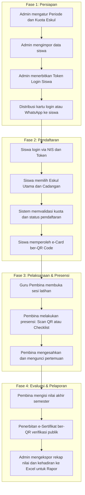

# Dokumen Alur Kerja Sistem Informasi Ekstrakurikuler (Bagimu Extra)
SMK Bagimu Negeriku Semarang

---

## 1. Pendahuluan

Bagimu Extra adalah sistem informasi berbasis web yang dirancang untuk mengelola seluruh siklus operasional kegiatan ekstrakurikuler di SMK Bagimu Negeriku Semarang secara digital, terpusat, dan terintegrasi.

Sistem ini memfasilitasi empat pihak utama:
1. Administrator / Operator Sekolah: Pengelola data master, periode, akun, dan rekapitulasi.
2. Siswa: Pemilih eskul dan pemilik kartu anggota digital (e-Card).
3. Guru Pembina Eskul: Penanggung jawab presensi mingguan, jurnal kegiatan, dan penilaian.
4. Kepala Sekolah: Pemantau laporan eksekutif dan statistik partisipasi siswa.

---

## 2. Diagram Alur Keseluruhan (End-to-End Workflow)

---

## 3. Rincian Alur Operasional Per Fase

### Fase 1: Persiapan Data & Distribusi Akun (Admin)

1. Pengaturan Periode Akademik
   - Admin menentukan tahun ajaran aktif, semester (Ganjil/Genap), dan jadwal jendela pendaftaran dibuka hingga ditutup.

2. Manajemen Master Ekstrakurikuler
   - Admin menentukan daftar nama eskul, deskripsi, hari pelaksanaan, lokasi latihan, nama pembina yang mengampu, serta kapasitas kuota maksimal siswa per eskul.

3. Manajemen Data Induk Siswa
   - Admin mengimpor atau memperbarui data siswa (Nama, NIS, NISN, Kelas, Jurusan, Kontak Wali). Data ini dapat diunggah massal melalui berkas Excel/CSV.

4. Penerbitan Kredensial Login Siswa
   - Siswa tidak perlu melakukan registrasi manual dengan email.
   - Admin menekan tombol Generate Token (bisa dilakukan secara massal untuk seluruh siswa atau per kelas). Sistem membuat token unik 8 digit untuk setiap siswa.

5. Distribusi Akses ke Siswa
   - Cetak Lembar Kartu Login: Admin mencetak lembar A4 berisi 8 kartu siap gunting per rombel, lengkap dengan QR Code login cepat.
   - Kirim via WhatsApp: Admin dapat mengirim pesan token otomatis ke nomor WhatsApp siswa atau orang tua dengan format pesan yang sudah disiapkan sistem.
   - Pembagian via Wali Kelas: Berkas rekap token dapat diekspor ke format Excel (.xlsx) untuk dibagikan oleh wali kelas masing-masing.

---

### Fase 2: Pendaftaran Ekstrakurikuler (Siswa)

1. Autentikasi Siswa
   - Siswa mengakses alamat portal pendaftaran pada peramban web (komputer atau ponsel pintar).
   - Siswa masuk menggunakan Nomor Induk Siswa (NIS) dan Token Login 8 digit yang telah diterima.

2. Pemilihan Ekstrakurikuler
   - Siswa melihat katalog eskul yang tersedia beserta informasi detail pembina, hari latihan, dan kuota tersisa yang terbarui secara real-time.
   - Siswa menentukan:
     - Eskul Utama: Pilihan prioritas pertama siswa.
     - Eskul Cadangan: Pilihan alternatif apabila kuota eskul utama telah terpenuhi atau melalui proses seleksi.
   - Siswa mengisi data pelengkap (nomor WhatsApp aktif dan alasan memilih eskul).
   - Siswa meninjau ringkasan pilihan dan menekan tombol konfirmasi pendaftaran.

3. Penerbitan Kartu Anggota Digital (e-Card)
   - Setelah pendaftaran tercatat dan disetujui, siswa memperoleh kartu anggota digital (e-Card).
   - e-Card memuat identitas siswa, kelas, nama eskul yang diikuti, serta QR Code unik berenkripsi.
   - Kartu ini dapat disimpan di ponsel atau dicetak fisik untuk dibawa saat latihan.

---

### Fase 3: Monitoring & Pengawasan Pendaftaran (Admin)

1. Dashboard Status Pendaftaran Per Rombel
   - Admin memantau progres keikutsertaan siswa melalui visualisasi grid status per rombel/kelas.
   - Setiap kartu kelas menampilkan persentase siswa yang sudah mendaftar dan siswa yang belum mendaftar.
   - Terdapat tautan cepat untuk melihat daftar nama siswa yang belum mendaftar agar dapat segera ditindaklanjuti oleh wali kelas.

2. Penyaringan Data Lanjutan (Filtering)
   - Data siswa dapat disaring berdasarkan:
     - Tingkat kelas (Kelas 10, Kelas 11, Kelas 12).
     - Rombel kelas spesifik (misal: 10 RPL 1, 11 Kuliner 2).
     - Jurusan (RPL, Kuliner, DKV, TP, TKP).
     - Status Pendaftaran (Sudah Terdaftar / Belum Mendaftar).
     - Status Siswa (Aktif / Nonaktif / Pindah / Alumni).

3. Ekspor Data Pendaftaran
   - Admin dapat mengunduh seluruh data atau data terfilter ke dalam format Excel (.xlsx) rapi dan CSV untuk keperluan arsip tata usaha sekolah.

---

### Fase 4: Pelaksanaan Latihan & Presensi Kehadiran (Guru Pembina)

1. Akses Portal Pembina
   - Guru pembina masuk menggunakan akun pembina masing-masing.
   - Di halaman utama, pembina langsung melihat daftar eskul yang diampunya beserta jumlah anggota aktif.

2. Pembuatan & Pencatatan Pertemuan
   - Setiap kali jadwal latihan tiba, sistem otomatis mengelompokkan kehadiran berdasarkan nomor pertemuan berurutan (Pertemuan 1, Pertemuan 2, dan seterusnya).

3. Metode Presensi Siswa
   - Metode Scan Kamera: Pembina membuka fitur pemindai QR pada ponsel atau laptop, lalu memindai QR Code pada e-Card siswa. Sistem langsung mencatat siswa bersangkutan Hadir secara real-time tanpa perlu mengetik manual.
   - Metode Pengisian Manual: Pembina menandai kehadiran melalui daftar hadir kelas dengan opsi: Hadir, Izin, Sakit, atau Alpa, disertai kolom catatan opsional.

4. Pengelolaan Perizinan Siswa
   - Siswa yang berhalangan hadir dapat mengajukan surat izin digital melalui portal siswa dengan mengunggah foto surat bukti.
   - Pembina dapat memvalidasi dan menyetujui atau menolak permohonan izin tersebut dari menu Perizinan.

5. Pengesahan & Penguncian Pertemuan
   - Setelah sesi latihan berakhir, pembina menekan tombol Kunci / Sahkan Pertemuan.
   - Setelah disahkan, data presensi terkunci permanen untuk mencegah manipulasi data absensi di kemudian hari.

---

### Fase 5: Evaluasi Akhir Semester & Sertifikat Digital

1. Penginputan Nilai Akhir
   - Menjelang penerimaan rapor semester, guru pembina mengakses menu Penilaian.
   - Pembina mengisi capaian kompetensi siswa berupa predikat nilai (A, B, C, D) serta deskripsi catatan perkembangan karakter dan keterampilan siswa.

2. Penerbitan e-Sertifikat Resmi
   - Sistem menghasilkan sertifikat digital resmi bagi siswa yang telah menyelesaikan masa kegiatan eskul dengan tingkat kehadiran minimal yang disyaratkan.
   - Setiap sertifikat dilengkapi nomor register unik dan QR Code verifikasi publik yang dapat dipindai oleh pihak eksternal untuk membuktikan keaslian dokumen.

3. Akses Siswa & Pelaporan ke Rapor
   - Siswa dapat melihat nilai akhir dan mengunduh berkas sertifikat dalam format PDF langsung dari akun mereka.
   - Admin mengunduh rekap nilai seluruh eskul untuk diserahkan kepada kurikulum dan wali kelas sebagai komponen nilai ekstrakurikuler pada rapor siswa.

---

## 4. Matriks Peran dan Hak Akses Pengguna

| Fitur / Menu | Siswa | Guru Pembina | Administrator | Kepala Sekolah |
| :--- | :---: | :---: | :---: | :---: |
| Login via NIS + Token | Ya | Tidak | Tidak | Tidak |
| Login via Akun Email / Password | Tidak | Ya | Ya | Ya |
| Pemilihan Eskul Utama & Cadangan | Ya | Tidak | Tidak | Tidak |
| Akses e-Card Ber-QR Code | Ya | Tidak | Tidak | Tidak |
| Pemindaian Absensi Siswa (Scan QR) | Tidak | Ya | Ya | Tidak |
| Pengesahan Pertemuan & Presensi | Tidak | Ya | Ya | Tidak |
| Input Nilai & Catatan Sikap Siswa | Tidak | Ya | Ya | Tidak |
| Manajemen Kuota & Master Eskul | Tidak | Tidak | Ya | Tidak |
| Generate & Distribusi Token Siswa | Tidak | Tidak | Ya | Tidak |
| Monitoring Progres Pendaftaran Rombel | Tidak | Tidak | Ya | Ya |
| Ekspor Data Rekapitulasi (Excel/PDF) | Tidak | Ya (Eskul sendiri) | Ya (Seluruh sekolah) | Ya |
| Akses Log Audit & Riwayat Perubahan | Tidak | Tidak | Ya | Ya |

---

## 5. Ringkasan Keunggulan Sistem

1. Tanpa Beban Registrasi Siswa: Siswa tidak perlu mengingat sandi rumit atau mendaftarkan email baru; cukup menggunakan NIS dan Token resmi dari sekolah.
2. Kuota Terkontrol Otomatis: Menghindari eskul kelebihan muatan kapasitas atau penumpukan siswa di satu bidang.
3. Presensi Cepat Berbasis QR: Mempercepat waktu absensi di lapangan saat jam latihan eskul berlangsung.
4. Data Transparan & Bebas Kertas: Seluruh proses mulai dari pendaftaran, perizinan, presensi, hingga sertifikat tersimpan rapi di dalam pangkalan data dan dapat dipertanggungjawabkan sewaktu-waktu.

